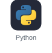
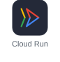
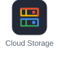

# Xosya Salassa

**Senior Cloud Data Engineer · 4× Google Cloud Certified**

Data Engineering · DataOps · Cloud Architecture

I’m a Google Cloud-certified data engineer with 4+ years of experience designing, developing, and maintaining enterprise data pipelines across retail, logistics, and automotive. I work with Python, SQL, BigQuery, Airflow, Cloud Run, and Terraform to build data workflows, automate reporting, and connect data platforms with operational tools.

[Portfolio](https://xsalassa.github.io/) · [LinkedIn](https://www.linkedin.com/in/xosyasalassa/) · [Medium](https://xsalassa.medium.com)

## Selected engineering work

- [Large-scale workbook generation](docs/case-studies/large-scale-workbook-generation.md) — manifest-based BigQuery batches and memory-conscious XLSX generation in Cloud Run Jobs.
- [Event-driven reporting infrastructure](docs/case-studies/event-driven-reporting-infrastructure.md) — reusable Terraform modules for manual container builds and authenticated Pub/Sub push to an HTTP worker.
- [Cross-cloud transfer reliability](docs/case-studies/cross-cloud-transfer-reliability.md) — disk-backed transfers from Cloud Storage to Amazon S3 with destination byte-size checks.
- [Workflow automation](docs/case-studies/monitoring-file-setup.md) — standardized workbook preparation and preservation of existing daily files.
- [Earlier reporting workflows](docs/case-studies/dynamic-reporting.md) — Airflow-orchestrated, request-driven XLSX and a separate direct CSV export.
- [Wanderlust Concierge](docs/projects/wanderlust-concierge.md) — a travel-planning AI prototype using Google ADK and Gemini. *Private source with a public overview.*

## Technical stack

**Core:** Python, SQL, BigQuery, Apache Airflow / Cloud Composer, Cloud Run / Jobs, Pub/Sub, Cloud Storage, Cloud Functions, Terraform, Docker, Cloud Build.

      

**Integration and reporting:** IAM/OIDC, Amazon S3, Looker, MySQL, XlsxWriter.

**Workflow automation:** Google Apps Script, Google Sheets, Power Automate, Power Automate Desktop, VBA, Excel Online. The [SQL-to-Excel study](docs/case-studies/sql-excel-sync.md) uses SQL Server.

## Google Cloud certifications

- [Professional Data Engineer](https://www.credly.com/badges/8127f88b-fa81-42f4-a84a-557b21a30a51/public_url)
- [Professional Cloud Database Engineer](https://www.credly.com/badges/0c20a9fd-b8b9-4379-9c8d-cf435b09ff61/public_url)
- [Professional Machine Learning Engineer](https://www.credly.com/badges/5804939d-2d40-463a-be50-72b61049a77d/public_url)
- [Generative AI Leader](https://www.credly.com/badges/f00fd682-68ae-4407-a595-cac6b5e37ce7/public_url)

## Technical writing

- [Building scalable reporting pipelines with Airflow on GCP](https://medium.com/edts/building-scalable-data-pipeline-orchestration-with-apache-airflow-on-gcp-dynamic-report-generation-12a0f6a207c8)
- [Avoiding repetitive work with Google Apps Script](https://medium.com/edts/how-to-avoid-repetitive-manual-work-with-one-google-apps-script-5b776674407a)
- [Automating daily project reports with Power Automate](https://xsalassa.medium.com/automating-your-daily-project-report-with-power-automate-0ddfab6f6297)

More engineering case studies and earlier projects

### Engineering case studies

- [Daily project updates](docs/case-studies/daily-project-report.md)
- [Report approvals and distribution](docs/case-studies/report-distribution.md)
- [SQL-to-Excel synchronization](docs/case-studies/sql-excel-sync.md)
- [PDF watermarking](docs/case-studies/pdf-watermarking.md)

### Earlier projects

- [Quantium retail analytics](https://github.com/xsalassa/Quantium)
- [Plant disease classification](https://github.com/xsalassa/Klasifikasi-Penyakit-Tanaman)
- [Sales Performance Report](https://github.com/xsalassa/Sales-Performance-Report)
- [Customer Analytics](https://github.com/xsalassa/Customer-Analytics-Report---SQL)
- [DQLab learning exercises](https://github.com/xsalassa/DQLab)

Earlier projects include educational analysis and academic experiments. Engineering studies document implementation and evidence limits.

## Contact

Connect on [LinkedIn](https://www.linkedin.com/in/xosyasalassa/), visit my [portfolio](https://xsalassa.github.io/), or browse my [GitHub repositories](https://github.com/xsalassa?tab=repositories).
