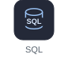
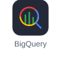
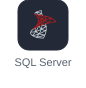
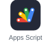
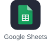
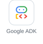
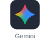
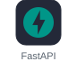
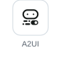

<h1>Hi, I'm Xosya</h1>

<strong>Data Engineer · Workflow Automation · AI Explorer</strong>

I work with Python, SQL, and Google Cloud to build data pipelines and reporting workflows. I also automate repetitive tasks and explore AI applications that connect information, tools, and people.

<h2>Selected work</h2>
<ul>
<li><strong><a href="docs/case-studies/dynamic-reporting.md">Cloud reporting workflows</a></strong> — orchestrating report requests and generating files with Airflow and Google Cloud.</li>
<li><strong><a href="docs/case-studies/monitoring-file-setup.md">Monitoring and workflow automation</a></strong> — preparing daily workbooks, synchronizing records, and distributing updates.</li>
<li><strong><a href="docs/projects/wanderlust-concierge.md">Wanderlust Concierge</a></strong> — a travel-planning AI prototype using Google ADK and Gemini. <em>Private source; public overview.</em></li>
</ul>
<h2>Tech stack</h2><h3>Languages & querying</h3>

<h3>Data pipelines & cloud</h3>

<h3>Workflow automation</h3>

<h3>AI applications</h3>

<h2>Writing</h2>
<ul>
<li><a href="https://medium.com/edts/building-scalable-data-pipeline-orchestration-with-apache-airflow-on-gcp-dynamic-report-generation-12a0f6a207c8">Building scalable reporting pipelines with Airflow on GCP</a></li>
<li><a href="https://medium.com/edts/how-to-avoid-repetitive-manual-work-with-one-google-apps-script-5b776674407a">Avoiding repetitive work with Google Apps Script</a></li>
<li><a href="https://xsalassa.medium.com/automating-your-daily-project-report-with-power-automate-0ddfab6f6297">Automating daily project reports with Power Automate</a></li>
</ul>
<h2>Let's connect</h2>

I'm happy to connect about data engineering roles, freelance automation projects, and AI collaborations.

<a href="https://xsalassa.medium.com">Medium</a> · <a href="https://github.com/xsalassa?tab=repositories">GitHub repositories</a>

More projects and engineering case studies

<h3>Engineering case studies</h3>
<ul>
<li><a href="docs/case-studies/dynamic-reporting.md">Cloud reporting</a></li>
<li><a href="docs/case-studies/monitoring-file-setup.md">Daily monitoring setup</a></li>
<li><a href="docs/case-studies/daily-project-report.md">Daily project updates</a></li>
<li><a href="docs/case-studies/report-distribution.md">Report approvals and distribution</a></li>
<li><a href="docs/case-studies/sql-excel-sync.md">SQL-to-Excel synchronization</a></li>
<li><a href="docs/case-studies/pdf-watermarking.md">PDF watermarking</a></li>
</ul>
<h3>Earlier projects</h3>
<ul>
<li><a href="https://github.com/xsalassa/Quantium">Quantium retail analytics</a></li>
<li><a href="https://github.com/xsalassa/Klasifikasi-Penyakit-Tanaman">Plant disease classification</a></li>
<li><a href="https://github.com/xsalassa/Sales-Performance-Report">Sales Performance Report</a></li>
<li><a href="https://github.com/xsalassa/Customer-Analytics-Report---SQL">Customer Analytics</a></li>
<li><a href="https://github.com/xsalassa/DQLab">DQLab learning exercises</a></li>
</ul>

These earlier projects include educational analysis and academic experiments. Each engineering study documents its implementation and evidence limits.

