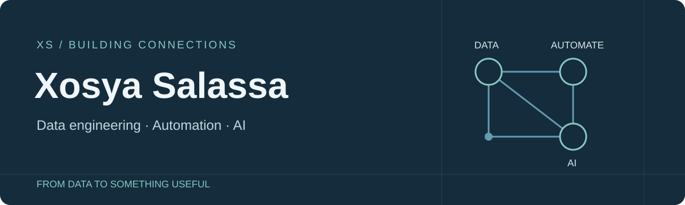

# Hi, I'm Xosya

**Data engineering. Practical automation. AI applications.**

I build data pipelines, automate reporting and operational workflows, and explore AI applications that connect tools and information. I enjoy the work between systems: getting data where it needs to go, making repetitive tasks easier, and turning an idea into something people can use.

[Featured work](#featured-work) · [Toolkit](#toolkit) · [Writing & case studies](#writing--case-studies) · [Let's connect](#lets-connect)

## Featured work

### Data engineering / From query to workbook

Reporting needs more than a query. This example uses **Airflow, BigQuery, Pub/Sub, and Cloud Run** to coordinate workbook requests, generate XLSX files, and check outputs before requesting notifications.

[Explore the reporting architecture →](docs/case-studies/dynamic-reporting.md)

### Automation / Less daily setup, clearer handoffs

Monitoring and reporting involve repeated preparation and updates. My examples use **Google Apps Script** to prepare daily checkpoint workbooks and **Power Automate** to turn an Excel checklist into project summaries and activity logs.

[Daily monitoring setup →](docs/case-studies/monitoring-file-setup.md) · [Project reporting workflow →](docs/case-studies/daily-project-report.md)

### AI / Wanderlust Concierge

Travel planning brings together preferences, destinations, and budgets. This **prototype** explores a conversational approach with **Google ADK, Gemini, Firestore, and an A2UI interface**. Its source repository is private; the public overview explains the implementation and its limits.

[Read the public project overview →](docs/projects/wanderlust-concierge.md)

## Toolkit

- **Data engineering:** Python · SQL · Apache Airflow · BigQuery · Cloud Storage · Pub/Sub · Cloud Run · XlsxWriter
- **Workflow automation:** Google Apps Script · Google Sheets · Power Automate · Excel Online · SQL Server · Power Automate Desktop
- **AI applications:** Google ADK · Gemini · Firestore · FastAPI · A2UI

## Writing & case studies

I document inputs, outputs, dependencies, and recovery paths. Each study includes its evidence and implementation limits.

- [Cloud reporting](docs/case-studies/dynamic-reporting.md) — orchestrating requests and generating report files.
- [Daily monitoring setup](docs/case-studies/monitoring-file-setup.md) — preparing workbooks and coordinating checks.
- [Daily project updates](docs/case-studies/daily-project-report.md) — turning a checklist into summaries and an activity log.
- [Report approvals and distribution](docs/case-studies/report-distribution.md) — routing files through approvals, updates, and notifications.
- [SQL-to-Excel synchronization](docs/case-studies/sql-excel-sync.md) — matching records and updating workbook rows.
- [PDF watermarking](docs/case-studies/pdf-watermarking.md) — applying image overlays in a desktop batch workflow.

[Read my articles on Medium](https://xsalassa.medium.com) · [About the diagrams and source captures](docs/visuals.md)

Earlier analytics, SQL, and academic projects

These projects reflect my earlier learning and experiments. Their documentation covers the available results and reproduction limits.

- [Quantium retail analytics](https://github.com/xsalassa/Quantium) — customer segmentation and store-trial comparisons in Python notebooks.
- [Plant disease classification](https://github.com/xsalassa/Klasifikasi-Penyakit-Tanaman) — academic CNN experiments with leaf images.
- [Sales Performance Report](https://github.com/xsalassa/Sales-Performance-Report) — educational retail sales and promotion analysis.
- [Customer Analytics](https://github.com/xsalassa/Customer-Analytics-Report---SQL) — SQL exercises on revenue, activity, and repeat transactions.
- [DQLab](https://github.com/xsalassa/DQLab) — SQL, Python, and R learning exercises.

## Let's connect

Have a data engineering role, a workflow to simplify, or an AI idea to explore? I'd be happy to talk about roles, freelance projects, and collaboration.

[Find me on Medium](https://xsalassa.medium.com) · [Explore my repositories](https://github.com/xsalassa?tab=repositories)
