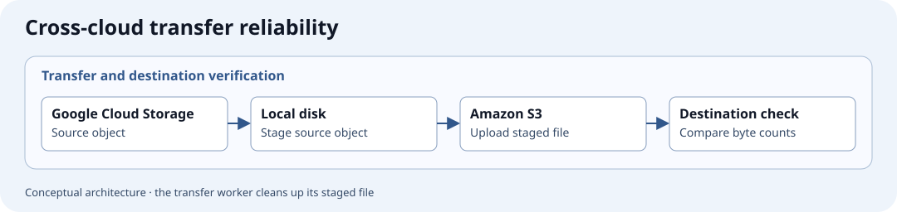

# Cross-cloud transfer reliability

Cross-cloud transfer workflows previously buffered entire objects in memory. The refactor introduced local disk staging and an explicit check on the destination object size.

## Role

I refactored the transfer workflows and added destination byte-size verification.

## Architecture

[Editable SVG diagram](../../assets/flows/cross-cloud-transfer-reliability.svg)

The transfer worker stages each source object on local disk, uploads the staged file to Amazon S3, and compares the destination byte count with the expected size. The workflow includes cleanup of the staged file.

## Engineering decisions

- Use disk-backed staging to avoid whole-object buffering.
- Make destination size verification explicit rather than treating upload completion as the only signal.
- Clean up staged files so transfer artifacts do not accumulate.

## Validation and limits

The evidence supports the change in processing strategy, cleanup, and destination byte-size verification. Matching byte counts can detect a size mismatch. Content equality, measured memory reductions, performance changes, and delivery guarantees are outside the available evidence. The diagram omits environment topology and names.
