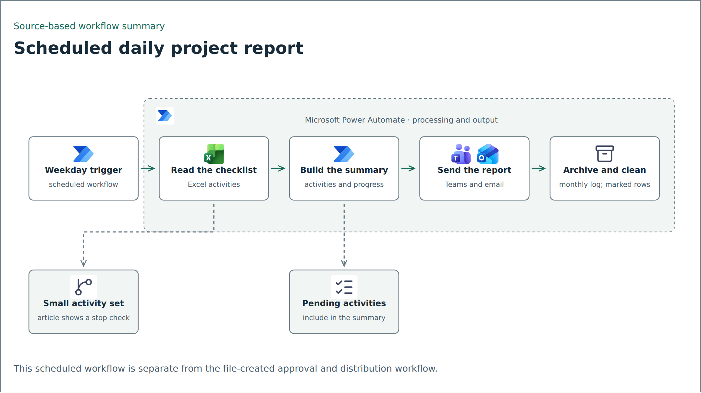
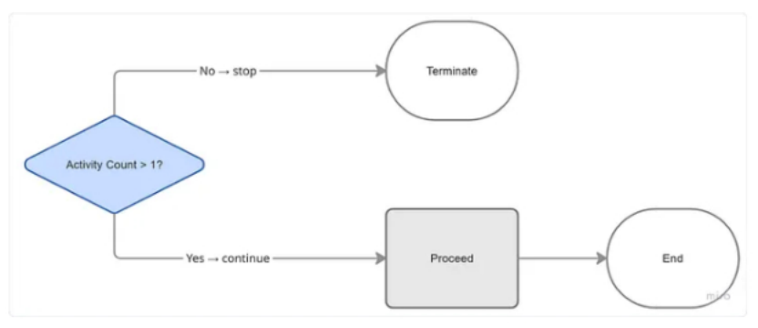

# Daily project updates with Power Automate

The article starts with a team collecting work updates in chat and manually assembling a summary. The documented replacement uses a shared Excel checklist as the reporting input.

## Workflow overview

<picture>
  <source media="(prefers-color-scheme: dark)" srcset="../../assets/flows/daily-project-report-dark.png">
  
</picture>

Simplified source-based diagram. [Editable Mermaid source](../../assets/flows/daily-project-report.mmd).

## Report flow described in the article

A weekday recurrence reads activity rows and an overall progress entry from an Excel workbook on SharePoint. The flow formats a timestamp, builds activity and pending-item summaries, posts a Teams overview and thread reply, and sends an HTML email.

It also appends a dated entry to a monthly report workbook and deletes checklist rows marked for cleanup. The article shows an activity-count condition that stops the flow for a small result set. Whether that condition correctly handles one valid activity depends on the table's actual header and row semantics; that behavior needs a fixture test.

Source article illustration after sanitization. Its count condition is not validated executable logic.

## Separate from the file-created workflow

The scheduled report and the file-created process are different workflows. The JSON stored in the supplied `ProjectProgress` package represents the latter: a file-created workflow with approval and distribution branches. The [file distribution case study](report-distribution.md) documents that export separately.

## Decisions and limits

Using a workbook gives contributors one structured place to submit updates. A Teams thread keeps the overview and detail together, while the monthly workbook preserves a dated record.

The article describes the workflow and shows outputs, but no matching runnable export or run history is supplied here. Its time-saving estimate has not been independently measured and is not repeated as a portfolio result.

A public demo should test empty inputs, a single activity, missing progress, HTML escaping, notification failure, reruns, and archival before cleanup. Use synthetic tasks and recipients; do not send test messages to real distribution lists.

## Source

Xsalassa, [We Were Sending Work Updates to WhatsApp Every Day. So We Automated It](https://xsalassa.medium.com/automating-your-daily-project-report-with-power-automate-0ddfab6f6297), published April 24, 2026. The article URL uses “Automating Your Daily Project Report with Power Automate.” It contains configuration snippets and describes replacing manual chat collection; it does not show a WhatsApp API integration.

No export of this scheduled workflow is included in the companion code package. The file-created report template is a separate workflow, not this article's implementation.
