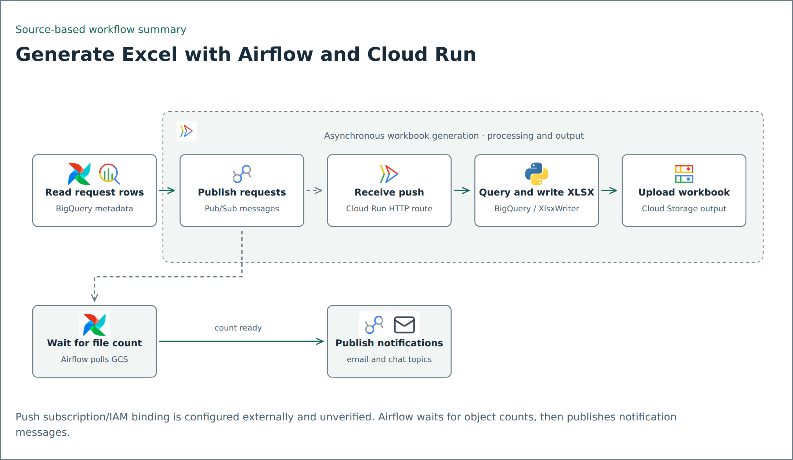
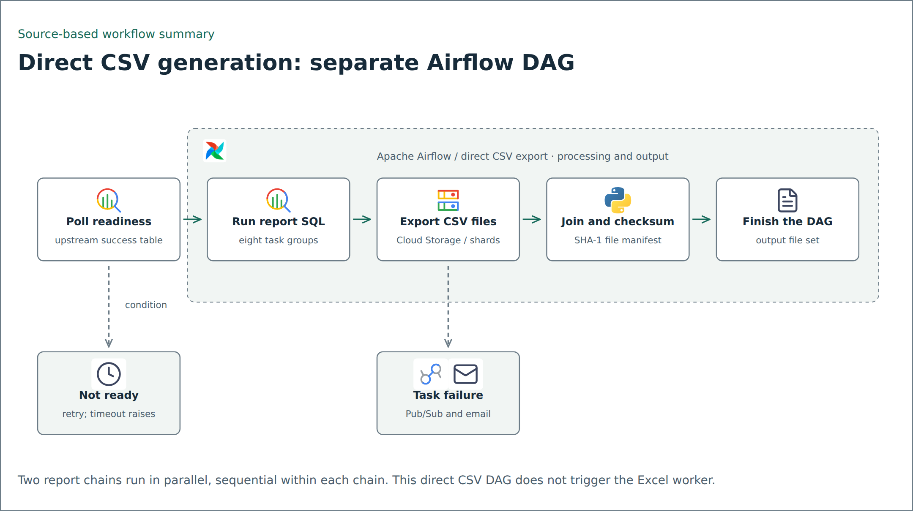

# Excel generation with Airflow, Pub/Sub and Cloud Run

Airflow orchestrates workbook generation by publishing requests. A Cloud Run worker reads each request, queries BigQuery, creates an XLSX workbook with XlsxWriter and uploads it to Cloud Storage. This is a different implementation from the direct CSV-export DAG previously shown as the main example.

## Excel-generation flow

<picture>
  <source media="(prefers-color-scheme: dark)" srcset="../../assets/flows/dynamic-reporting-dark.png">
  
</picture>

[Editable Mermaid source](../../assets/flows/dynamic-reporting.mmd). The dashed producer-to-worker connection denotes an externally configured Pub/Sub push subscription and invoker IAM binding. Matching message fields and the HTTP consumer are present in source; the binding and deployed execution were not verified.

1. Airflow invokes the publisher with a metadata table, generation topic and destination bucket.
2. The publisher reads report type, source table, filters, format, filename and destination folder. It emits one request per row.
3. The worker's `POST /generate_excel` endpoint decodes the Pub/Sub `message.data` payload.
4. For `Report_type: excel_table` and `Format: xlsx`, the callback queries BigQuery into a DataFrame, writes the workbook, uploads it to GCS and records an operational log.
5. Airflow separately polls output object counts, then publishes email requests followed by chat requests to their respective topics. Publishing a notification request does not prove delivery.

The payload keys are `Report_type`, `Table`, `Filter`, `Format`, `Target_filename`, `Target_bucket`, `Target_folder`, and `Client_Project_Id`. The companion `airflow-reporting/excel-generation/` folder includes the selected publisher, extracted XLSX writer method, a synthetic payload and local contract/writer tests. It does not include a complete deployable worker or the external subscription.

## Decisions and limits

Separating orchestration from workbook generation lets the DAG express completion and notification dependencies while the worker handles data formatting. That separation needs explicit message and completion contracts.

The inspected completion helper compares object counts with distinct expected filenames; it does not validate every filename, freshness or content. The publisher retries but prints final failures without raising. SQL/table fragments and filenames are trusted configuration in this source and need validation before accepting untrusted input. The main diagram describes XLSX: the legacy worker's nominal CSV branch still uses XlsxWriter bytes and must not be treated as valid CSV output.

Local tests compare payload keys and exercise the extracted writer with a fake workbook implementation. No actual XLSX file, cloud request, deployment or notification was produced by those tests. Cost, throughput and delivery reliability have not been measured.

## Separate direct CSV implementation

<picture>
  <source media="(prefers-color-scheme: dark)" srcset="../../assets/flows/csv-generation-dark.png">
  
</picture>

The retained `airflow-reporting/airflow_reporting/` source is a separate direct CSV pipeline: readiness polling, eight SQL task groups in two parallel chains, GCS export with shard composition, and a joined SHA-1 manifest. It does not trigger the Excel worker. Its private notification integrations remain explicit stubs; no Airflow import, SQL execution or production run was performed.

## Article and code provenance

Xsalassa, [Building Scalable Data Pipeline Orchestration with Apache Airflow on GCP: Dynamic Report Generation at Scale](https://medium.com/edts/building-scalable-data-pipeline-orchestration-with-apache-airflow-on-gcp-dynamic-report-generation-12a0f6a207c8), published May 8, 2026, is background for the direct CSV/manifest example. The Excel pattern above is independently grounded in the inspected Excel-generation DAG, matching publisher and Cloud Run consumer code. It is not claimed as the same article implementation.
