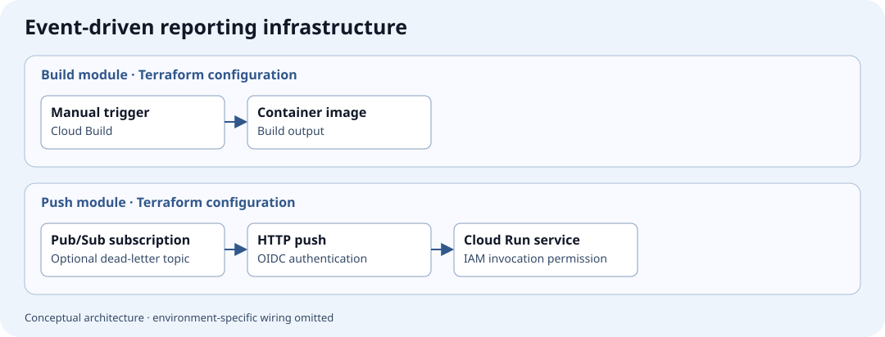

# Event-driven reporting infrastructure

Reporting services need repeatable build configuration and a controlled path for event delivery to an HTTP worker. Keeping infrastructure definitions reusable makes those contracts easier to maintain across workflows.

## Role

I contributed technical design, Terraform development, and testing for reusable infrastructure, and coordinated deployment with the team lead. The team lead executed production deployments.

## Architecture

[Editable SVG diagram](../../assets/flows/event-driven-reporting-infrastructure.svg)

The build module configures a manually invoked Cloud Build trigger for container image builds. Separately, the Pub/Sub module configures HTTP push with OIDC and the IAM invocation permission for Cloud Run. The module supports optional dead-letter topic configuration.

## Engineering decisions

- Encode trigger and subscription configuration in Terraform for repeatable review.
- Give the push identity the required invocation permission and configure an OIDC token for HTTP requests.
- Keep dead-letter handling configurable. It applies where the subscription is configured to use it.

## Validation and limits

The evidence is the verified module configuration and supported options. It establishes the intended invocation model. The diagram is conceptual and does not establish that optional settings were enabled, that any specific release deployed automatically, or that messages were delivered successfully. The HTTP push path and the [batch workbook job](large-scale-workbook-generation.md) are separate architectures.
