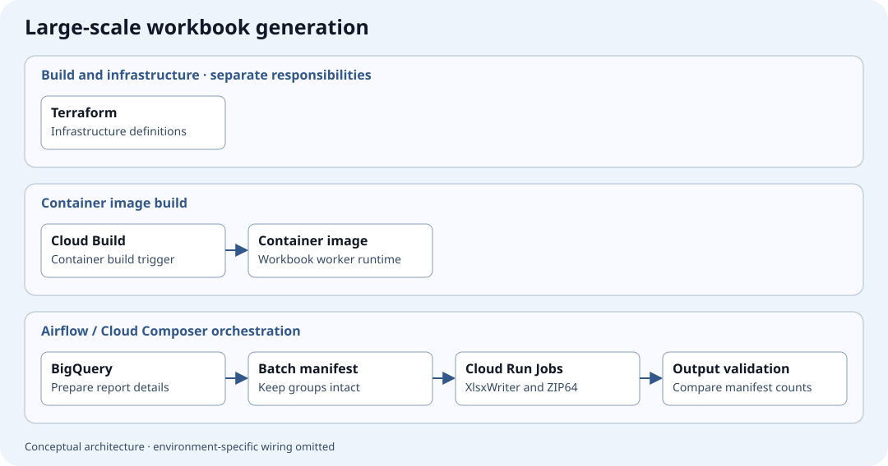

# Large-scale workbook generation

Large report preparations need predictable workbook partitions and a way to detect incomplete output before the result is used. Splitting at arbitrary row boundaries can separate records that belong together.

## Role

I contributed to technical design, development, testing, and maintenance. The team lead handled production deployment execution.

## Architecture

[Editable SVG diagram](../../assets/flows/large-scale-workbook-generation.svg)

Airflow in Cloud Composer coordinates BigQuery preparation. A manifest defines complete groups and expected workbook outputs. Cloud Run Jobs processes those batches and writes XLSX files with XlsxWriter. Terraform configuration and Cloud Build image builds are separate from runtime orchestration.

## Engineering decisions

- Keep report groups intact when partitioning work. The manifest provides a common contract for preparation, generation, and validation.
- Use XlsxWriter constant-memory mode with sequential writes and enable ZIP64 for large workbook archives.
- Compare workbook output counts with the manifest to check batch completeness.

## Validation and limits

The evidence comes from checked development executions that produced workbook outputs. This supports the generation and output-count claims in this study. Production throughput, memory savings, workbook content equivalence, and downstream delivery were outside that evidence. The diagram summarizes responsibilities and omits environment wiring. The [earlier request-driven XLSX worker](dynamic-reporting.md) is a separate implementation that reads a DataFrame.
