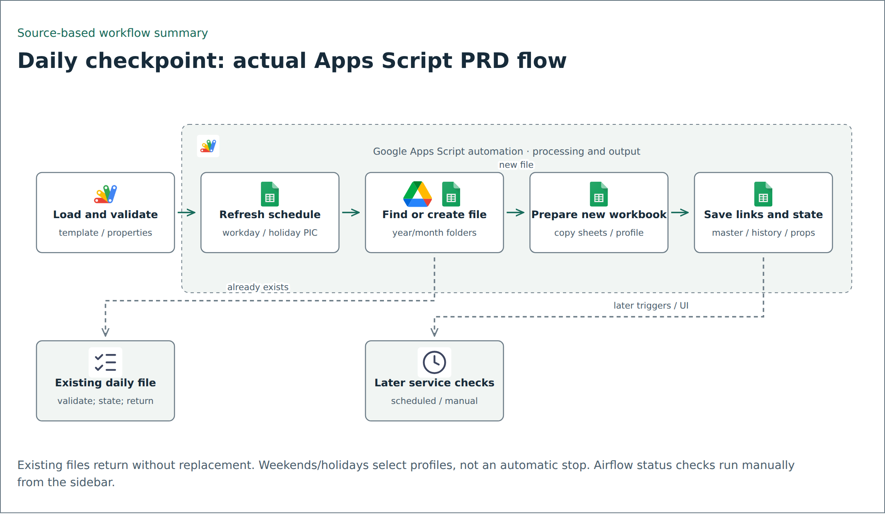

# Daily checkpoint preparation with Google Apps Script

The selected PRD script prepares a dated monitoring workbook and coordinates the schedules and checks around it. The diagram below follows the copied implementation, including its early return when today's file already exists.

## Actual PRD flow

<picture>
  <source media="(prefers-color-scheme: dark)" srcset="../../assets/flows/monitoring-file-setup-dark.png">
  
</picture>

[Editable Mermaid source](../../assets/flows/monitoring-file-setup.mmd). This is a code-based flow summary, not a production execution trace.

1. `copyTemplateDaily` reads generic Script Properties, opens the template and validates its structure.
2. It refreshes the schedule, classifies the date and resolves PIC assignments. Nonworking dates use the next working day's first PIC for both roles. Three or more consecutive nonworking dates form a long holiday.
3. It locates or creates the year/month Drive folders and checks for today's daily file.
4. **Existing file:** validate it, refresh runtime properties, log `ALREADY_EXISTS`, preserve its contents and return. This branch does not rebuild sheets or continue to master-link updates.
5. **New file:** create an empty spreadsheet, copy the template sheets without its bound script, apply the weekday/nonworking profile, populate dates/PICs, update formulas and master links, and save runtime/history information.

Weekends and holidays select different workbook profiles; they do not automatically stop daily-file preparation. This source does not implement the earlier article's Monday creation of multiple historical daily files.

## Later monitoring checks

| Check | Selected source behavior |
| --- | --- |
| Looker | Scheduled checks at 14:00 and 16:00; the nonworking-day 16:00 check is not applicable |
| File status | Scheduled 09:00 check against BigQuery-backed metadata |
| Platform monitoring | Separate weekday 07:00 and nonworking-day 08:00 handlers |
| Airflow status | Manual from the sidebar; trigger setup removes old scheduled Airflow handlers |
| Holiday edits | On-edit schedule refresh and pending-change warning |
| Daily file | Optional time trigger controlled by `DAILY_COPY_HOUR`, or manual invocation |

These are configured entry points, not proof that the triggers or external integrations were enabled.

## Code and validation

The companion `apps-script-monitoring/` folder contains 19 `.gs` modules, two runtime HTML components and the manifest. `02_template_service.gs`, `06_trigger_service.gs`, `09_monitoring_day_service.gs` and `10_schedule_engine.gs` define the flow above. Organization labels, project/workspace identifiers, selected branch codes and notification addresses use generic aliases. Workbook data, source documents, deployment identity and live Script Properties are excluded.

Five local Node tests cover calendar classification, long holidays/next-workday behavior, recipient parsing, subject separators, HTML includes and macro resolution. No hosted Apps Script run, permission grant, email, API call or workbook write was performed. Test partial creation, duplicate invocations, conflicting schedules and quotas in a dedicated synthetic environment before adapting.

## Earlier article

Xsalassa, [How to Avoid Repetitive Manual Work with One Google Apps Script](https://medium.com/edts/how-to-avoid-repetitive-manual-work-with-one-google-apps-script-5b776674407a), published May 8, 2026. The article is background for the template-copy pattern; the diagram and behavior above come from the later selected PRD code. The historical article log capture is documented separately in visual provenance and is not a fresh run log.
