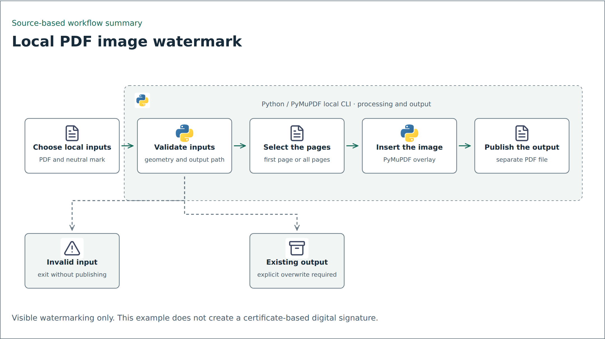
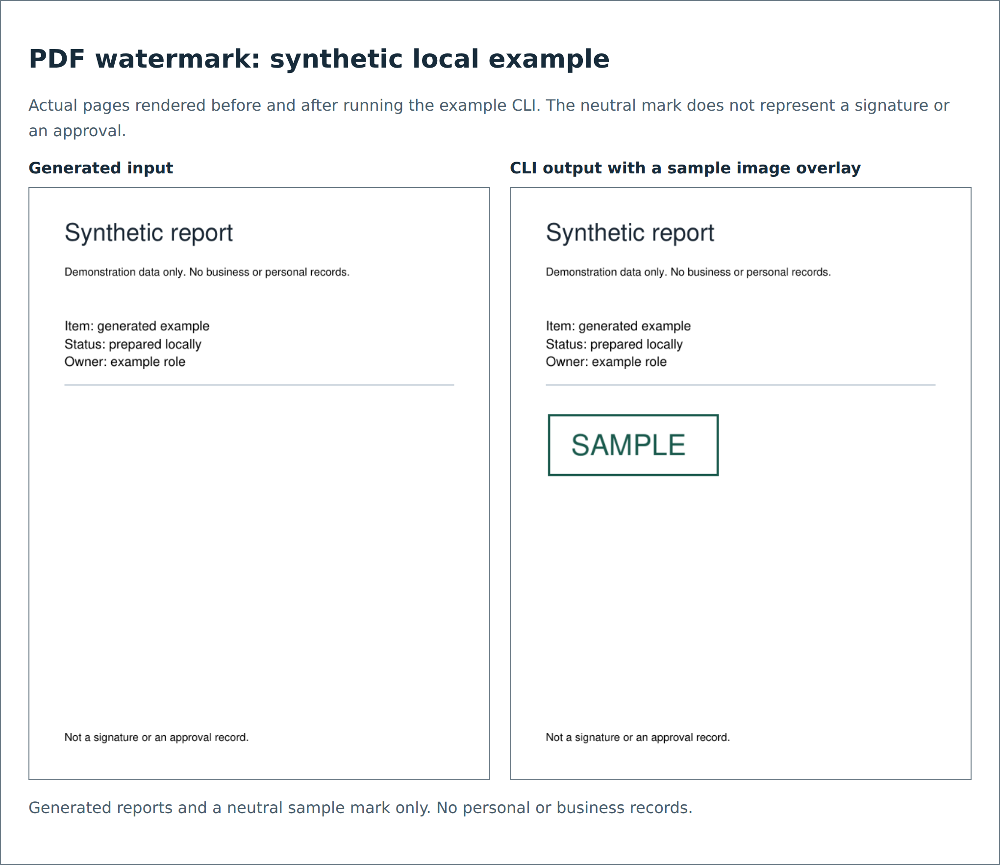

# PDF watermarking with Python and Power Automate Desktop

The supplied setup guide combines a desktop file loop with a Python script that inserts an image into a PDF. It documents a practical batch-processing task and the steps needed to configure another workstation.

## Workflow overview

<picture>
  <source media="(prefers-color-scheme: dark)" srcset="../../assets/flows/pdf-watermarking-dark.png">
  
</picture>

Simplified illustration of the companion Python example. [Editable Mermaid source](../../assets/flows/pdf-watermarking.mmd).

## Documented workflow

An operator places PDFs in an input folder and starts a Power Automate Desktop flow. The flow lists PDF files, builds an output filename for each one, and invokes Python with the input PDF, image, and output path.

The embedded PyMuPDF script opens the first page, calculates an image rectangle from offsets and a scale value, inserts the image, and saves the result to a separate output path. The guide includes a manual command-line check and troubleshooting notes for Python paths, missing modules, and image placement.

## What the output means

An image overlay is a visible mark. It is not a certificate-based digital signature and does not prove identity or make document changes detectable. The source uses signing terminology, but this summary describes the operation as watermarking.

## Review notes

The script's offset and scale defaults differ from the guide's parameter table. The script changes the first page only. Its optional opacity branch draws a white rectangle over the inserted image; that should not be described as verified image-alpha handling.

The desktop example defines a Python path variable but uses a literal executable path in its run action. A reusable version should use one configured path, validate arguments and output collisions, close resources on errors, and handle each process exit code.

## Limits and reproduction work

The original guide's script and desktop flow were not executed. A companion Python example was subsequently implemented and tested locally with generated PDFs and a neutral sample mark. It covers first/all-page processing, invalid input, existing output, and unsupported page geometry. It is a reconstruction with different validation and output handling, not verification of the original desktop deployment.

Actual local CLI result with synthetic inputs. No real signature image or business document was used.

## Source

The supplied “Guideline Power Automate - Sign PDF” document, headed “Panduan Setup: PDF Watermark.” No signature asset or source PDF is bundled.
