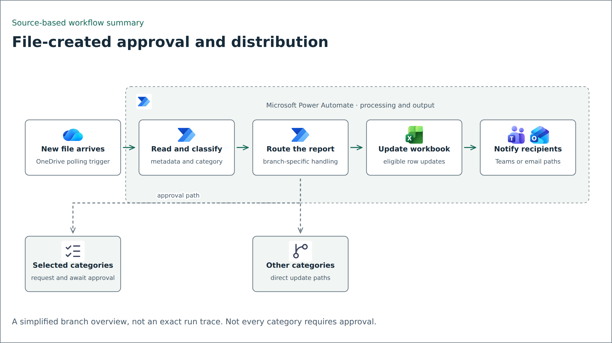

# File approvals and report distribution

Incoming report files need to reach the right workbook and recipients. The supplied Power Automate definition routes files according to report-specific conditions rather than treating every upload the same way.

## Workflow overview

<picture>
  <source media="(prefers-color-scheme: dark)" srcset="../../assets/flows/report-distribution-dark.png">
  
</picture>

Simplified source-based diagram; individual branches have separate conditions. [Editable Mermaid source](../../assets/flows/report-distribution.mmd).

## What the export contains

The trigger polls OneDrive for newly created files. The definition includes file metadata lookup, Excel row updates, share-link creation, and conditional branches for different report categories.

Some report paths create an approval, wait for its outcome, and then update workbook records. Other paths update rows directly. The definition also includes an Excel script action for pivot refresh and Teams or email delivery paths.

These are configured operations found by inspecting the JSON. Their presence does not prove successful execution, connector authorization, or a working end-to-end deployment.

## Engineering considerations

Routing makes the destination depend on the file category. Approval branches express a human decision before selected updates. Combining links and workbook metadata can help readers locate the relevant report, provided the underlying sharing permissions are appropriate.

Before rebuilding this pattern, define a stable file identifier and an idempotency rule. Test duplicate file events, unknown categories, rejected or expired approvals, missing workbook rows, failed pivot refresh, and notification errors. Review share-link scope rather than assuming a generated link is private.

## Limits

The export refers to environment-specific connections, workbooks, folders, and recipients. It cannot be imported and run as a generic demo without replacement configuration and authorized connections. Raw definitions and connection maps are not included in this public summary. No delivery-success rate or runtime improvement is claimed.

## Source

The supplied Power Automate package labeled `Project Progress`. An identical definition also appears inside the supplied `Polreg New Data` export tree. This workflow is distinct from the [scheduled daily checklist report](daily-project-report.md).
