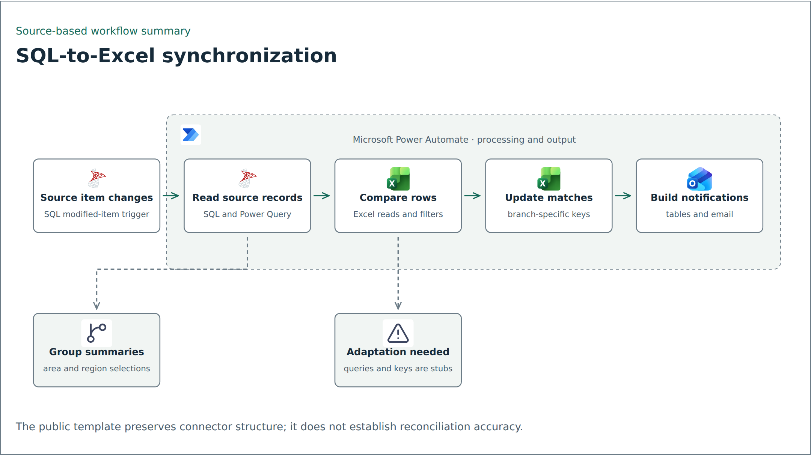

# SQL-to-Excel synchronization with Power Automate

The supplied flow definition connects SQL Server records with Excel workbooks and notification outputs. The portfolio value is the comparison and update logic, with the environment-specific details removed.

## Workflow overview

<picture>
  <source media="(prefers-color-scheme: dark)" srcset="../../assets/flows/sql-excel-sync-dark.png">
  
</picture>

Simplified source-based diagram. [Editable Mermaid source](../../assets/flows/sql-excel-sync.mmd).

## What the definition shows

A SQL item-modified trigger starts the workflow. SQL/Power Query operations retrieve source records, Excel actions read workbook rows, and filters compare the two sets. Subsequent actions select fields, parse structured results, and update matching workbook rows.

The definition also contains area and region grouping, HTML table creation, and email actions. Similar branches appear more than once, so a reconstruction needs to establish which path owns each output rather than assuming the branches are interchangeable.

## Decisions to validate

An event-triggered update can keep a reporting workbook aligned with source changes without asking someone to refresh it manually. That depends on the row key, null handling, data types, and behavior when an event is delivered again.

For a public reconstruction, use synthetic source and workbook records. Specify the matching key and test insert-versus-update behavior, missing matches, duplicate keys, repeated events, numeric formatting, and connector failures. If concurrent runs update the same workbook, validate the write strategy under contention.

## Limits

Static inspection confirms the configured trigger and actions. It does not establish exactly-once processing, reconciliation accuracy, connector performance, or production reliability. The source database, workbook data, and run history are not available in this package.

## Source

The supplied Power Automate package labeled `Polreg New Data`. Its nested export contains an identical copy of the same definition. Database endpoints, business identifiers, workbook locations, and recipients are excluded from this write-up.
